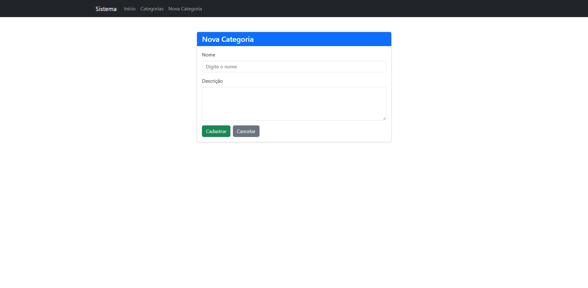
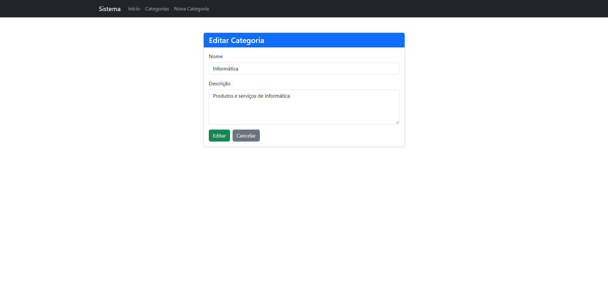
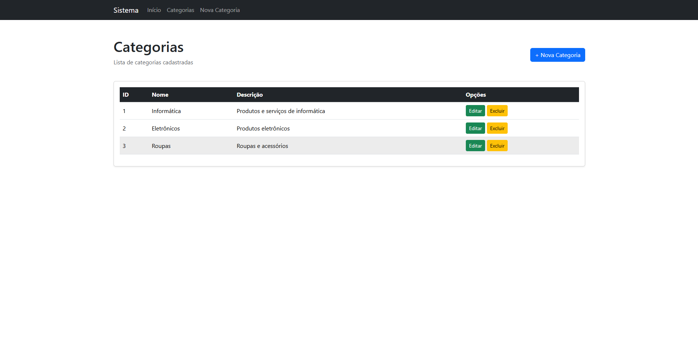
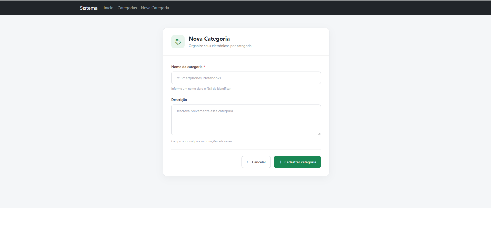
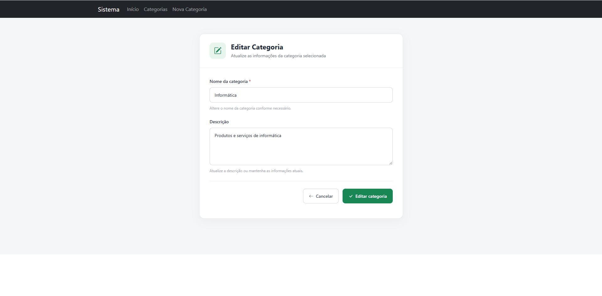
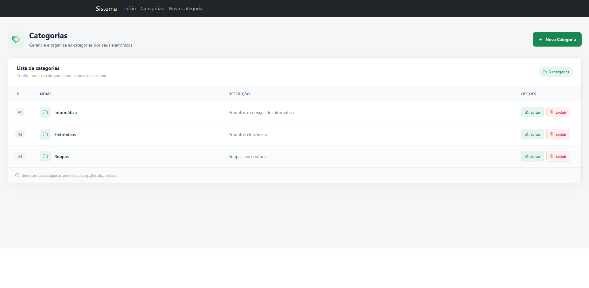

Gerenciador de categorias
Enrico Merlin Pires e Arthur Araújo Spina

O objetivo de site é dar a possibilidade ao usuario de criar, editar, deletar e mostrar ao usuario as categorias criadas por ele mesmo.
Ele foi feito com Ejs, JavaScript, Node.JS, css, bootstrap com auxilio do ChatGPT.

As funcionalidades são Navegação simples, Criação, Edição, Deletar e Mostrar ao usuario as categorias.

Propts utilizados na IA:
Link da conversa
https://chatgpt.com/share/6aea1cf9-3f44-83e9-9ce2-ac61cb905c86

Antes da Restilização

Depois da Restilização

Parte feita pelo grupo a mão sem o uso da ia:
Toda a parte logica foi feita a mao e/ou com apoio do material do professor. A IA foi utilizada apenas no auxilio da estilização e em problemas logicos.

Link do Render:
https://gerenciador-de-categorias.onrender.com/
